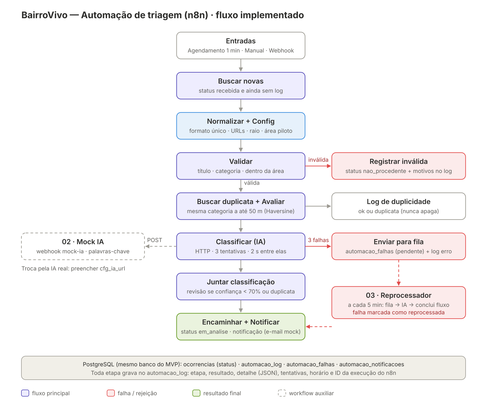

# BairroVivo — Automação (RPA)

Automação da triagem de ocorrências do **BairroVivo**, a plataforma de zeladoria urbana do grupo na FIAP Global Solution 2026.2. Este repositório é a entrega da disciplina de **RPA / Automação**.

> ⚠️ **Dados 100% fictícios.** O MVP sobe com ocorrências sintéticas e todos os testes usam dados inventados. Não há fotos nem dados pessoais reais.

| Item | Link |
|---|---|
| MVP (disciplina de DevOps) | https://github.com/victorasfur/bairrovivo-secure |
| Este repositório | https://github.com/andre-soler/bairrovivo-automacao |

---

## O que a automação faz

Toda ocorrência nova registrada no BairroVivo é processada pelo **n8n** em até 1 minuto, sem intervenção humana:

1. **Validar:** título, categoria e localização dentro da área piloto. Se for inválida, a ocorrência vai para `nao_procedente` com os motivos registrados.
2. **Duplicidade:** procura ocorrência aberta da mesma categoria a até 50 m, usando a fórmula de Haversine em SQL. **Uma possível duplicata nunca é apagada:** ela segue marcada para revisão.
3. **Classificar (IA):** chama a API de IA por HTTP, com 3 tentativas. Hoje usa um mock; a IA real entra trocando uma URL.
4. **Encaminhar:** muda o status para `em_analise`. Vai para revisão manual se a confiança for menor que 70%, se a IA sugerir outra categoria ou se for possível duplicata.
5. **Notificar:** registra a mensagem para o cidadão (e-mail simulado).
6. **Falha:** se a IA falhar 3 vezes, a ocorrência vai para a **fila de falhas**, e o **reprocessador** tenta de novo a cada 5 minutos.

Cada etapa grava uma linha em `automacao_log` com o resultado, um detalhe em JSON, o número de tentativas, o horário e o ID da execução do n8n.



## Os três workflows

| Arquivo | Workflow | Função |
|---|---|---|
| [`workflows/01-triagem-principal.json`](workflows/01-triagem-principal.json) | 01 - Triagem principal | O fluxo completo, disparado a cada 1 minuto, manualmente ou por webhook |
| [`workflows/02-mock-ia.json`](workflows/02-mock-ia.json) | 02 - Mock IA | API que simula a IA: classifica por palavras-chave e responde no mesmo formato da API real |
| [`workflows/03-reprocessador.json`](workflows/03-reprocessador.json) | 03 - Reprocessador | A cada 5 minutos, reprocessa o que está na fila de falhas |

## Arquitetura adaptável

A automação funciona com o MVP como ele está e recebe as peças das outras disciplinas sem refazer o fluxo. Tudo que pode mudar fica no nó **Config**:

| Configuração | Valor atual | Para que serve |
|---|---|---|
| `cfg_ia_url` | vazio (usa o mock) | URL da API de IA real |
| `cfg_cv_url` | vazio | URL da API de visão computacional, quando o MVP tiver fotos |
| `cfg_raio_dup_m` | 50 | Raio, em metros, da busca de duplicidade |
| `cfg_lat_min` … `cfg_lng_max` | Vila Mariana | Retângulo da área piloto |

| Peça | Hoje | Quando chegar |
|---|---|---|
| Entrada de ocorrências | Polling no banco a cada 1 min | Webhook do backend (já existe: `POST /webhook/nova-ocorrencia`) |
| Classificação por IA | Mock por palavras-chave | Preencher `cfg_ia_url` |
| Notificação | Tabela `automacao_notificacoes` (mock) | Canal real (e-mail ou app) |

O contrato esperado da API de IA é: recebe `{ id, titulo, descricao, categoria }` e devolve `{ id, categoria_sugerida, confianca, modelo, justificativa }`.

## Stack

| Componente | Tecnologia |
|---|---|
| Orquestração | n8n (Docker) |
| Banco | PostgreSQL 16, o mesmo do MVP |
| MVP | Imagem `ghcr.io/victorasfur/bairrovivo-secure` (FastAPI) |
| Execução | Docker Compose |

## Como rodar

Pré-requisito: **Docker Desktop** aberto, com o engine rodando.

```bash
git clone https://github.com/andre-soler/bairrovivo-automacao.git
cd bairrovivo-automacao
cp .env.example .env        # no PowerShell: Copy-Item .env.example .env
# edite o .env: defina POSTGRES_PASSWORD e N8N_ENCRYPTION_KEY
docker compose up -d
```

Crie as tabelas da automação (depois que o app subiu e criou a tabela `ocorrencias`):

```bash
# Linux/macOS
docker compose exec -T db psql -U bairrovivo -d bairrovivo < sql/001_tabelas_automacao.sql
# PowerShell
Get-Content sql\001_tabelas_automacao.sql | docker compose exec -T db psql -U bairrovivo -d bairrovivo
```

| Serviço | Endereço |
|---|---|
| MVP BairroVivo | http://localhost:8000 |
| n8n | http://localhost:5678 |

### Configuração do n8n

1. Crie a conta de dono em http://localhost:5678.
2. Crie uma credencial **Postgres** chamada `Postgres account`: host `db`, porta `5432`, banco e usuário iguais aos do `.env`, SSL desabilitado (o tráfego não sai da rede interna do Docker).
3. Importe os workflows, nesta ordem, cada um num workflow novo (**⋯ → Import → From File**):
   1. `02-mock-ia.json` → **Publish**
   2. `01-triagem-principal.json` → **Publish**
   3. `03-reprocessador.json` → **Publish**

Se algum nó Postgres aparecer sem credencial depois da importação, selecione `Postgres account` nele.

Para parar sem perder dados: `docker compose down`. O `docker compose down -v` apaga os volumes, inclusive os workflows do n8n.

## Produção

Em produção, a automação roda **na mesma VM Azure do MVP**, num projeto Compose separado que só entra na rede interna do MVP para enxergar o banco. Nenhuma porta nova é aberta, nenhum arquivo do repositório do MVP muda e a senha do banco é lida do `.env` que já existe na VM.

| Item | Valor |
|---|---|
| URL pública do MVP | http://172.173.103.106 |
| Painel do n8n | só por túnel SSH: `ssh -L 5678:localhost:5678 azureuser@172.173.103.106` |
| Instalação | `sudo bash deploy/instalar-na-vm.sh` (na VM) |

Passo a passo, arquitetura e operação: [`deploy/PRODUCAO.md`](deploy/PRODUCAO.md).

## Demonstração: os três cenários

**1. Registro normal**

```powershell
$c = @{ titulo="Entulho jogado na esquina"; descricao="Muito lixo e entulho acumulado"; categoria="descarte"; latitude=-23.6000; longitude=-46.6250; alias="Joao" } | ConvertTo-Json
Invoke-RestMethod -Method Post -Uri "http://localhost:8000/api/ocorrencias" -Body $c -ContentType "application/json; charset=utf-8"
```

Em até 1 minuto, a ocorrência aparece como **"Em análise"** no site, e a notificação fica em `automacao_notificacoes`.

**2. Duplicidade provável**

Registre outra ocorrência da mesma categoria a poucos metros de uma já aberta (mude só a última casa decimal da latitude). Ela é marcada como `duplicata` no log, apontando a original e a distância, e o encaminhamento vai para `revisao`.

**3. Falha recuperada**

1. No workflow **02 - Mock IA**, clique em **Unpublish** (a "IA" sai do ar).
2. Registre uma ocorrência. A classificação falha 3 vezes e a ocorrência vai para `automacao_falhas`.
3. Publique o mock de novo. Em até 5 minutos, o reprocessador conclui o fluxo e marca a falha como `reprocessada`.

**Consultas úteis**

```bash
docker compose exec db psql -U bairrovivo -d bairrovivo -c "SELECT ocorrencia_id, etapa, resultado, tentativas FROM automacao_log ORDER BY id;"
docker compose exec db psql -U bairrovivo -d bairrovivo -c "SELECT ocorrencia_id, mensagem FROM automacao_notificacoes;"
docker compose exec db psql -U bairrovivo -d bairrovivo -c "SELECT id, ocorrencia_id, status, tentativas, erro FROM automacao_falhas;"
```

As evidências (prints das execuções e do banco) estão em [`docs/evidencias/`](docs/evidencias/).

## Decisões de projeto

- **Polling em vez de webhook como entrada principal:** o MVP já foi entregue e avaliado, e o backend não avisa quando uma ocorrência é criada. O polling não exige mudar o código de outra disciplina. O webhook já está pronto para quando o backend passar a chamar.
- **"Já processada" = já tem linha no log:** o `Buscar novas` só pega ocorrências `recebida` sem nenhum registro em `automacao_log`. Assim nenhuma ocorrência é processada duas vezes.
- **Duplicata não bloqueia:** ela segue o fluxo inteiro, mas sempre com revisão manual. A automação sugere; quem decide é o operador.
- **IA chamada por HTTP, mesmo sendo mock:** o mock responde no mesmo contrato da API real, então a troca não muda o fluxo, e a falha de rede é testável de verdade.
- **Falha pela saída de erro do nó:** em vez de um Error Workflow genérico, o nó de classificação desvia o item para a fila com a ocorrência completa. Assim o reprocessador tem tudo que precisa.
- **SQL com parâmetros (`$1`, `$2`…):** nenhum dado é colado direto no SQL, o que evita SQL injection.

## Segurança

- **Sem segredos no repositório:** o `.env` fica fora do Git (`.gitignore`); só o `.env.example` é versionado. Os workflows exportados guardam apenas o nome da credencial, nunca a senha.
- **Portas só locais:** MVP e n8n escutam em `127.0.0.1`; o banco não publica porta nenhuma.
- **Credenciais criptografadas** no n8n com `N8N_ENCRYPTION_KEY`.
- **Container do n8n** com `no-new-privileges`.
- **Tabelas próprias:** a automação grava em `automacao_*` e, na tabela do MVP, só altera o `status`.
- **Validação da entrada:** tudo que chega (inclusive pelo webhook) passa pelo Validar, e o banco recusa resultados fora da lista permitida (`CHECK`).

## Estrutura

```
.
├── docker-compose.yml        # ambiente local: db + app (MVP) + n8n
├── .env.example              # variáveis sem segredos
├── deploy/
│   ├── docker-compose.prod.yml   # produção: só o n8n, na rede do MVP
│   ├── instalar-na-vm.sh         # instalação na VM
│   └── PRODUCAO.md
├── sql/
│   └── 001_tabelas_automacao.sql
├── workflows/
│   ├── 01-triagem-principal.json
│   ├── 02-mock-ia.json
│   └── 03-reprocessador.json
└── docs/
    ├── diagrama-automacao.pdf / .png
    └── evidencias/
```

## Limitações

- O MVP não tem upload de fotos, então a visão computacional não é chamada (`cfg_cv_url` fica reservado).
- A classificação usa um mock por palavras-chave até a API de IA da outra disciplina existir.
- A notificação é simulada: a mensagem é gravada em tabela, não enviada.
- A entrada por polling tem até 1 minuto de atraso.
- Em produção, a automação depende da VM do MVP: se ela for destruída (`terraform destroy`), basta rodar o script de instalação de novo depois do `terraform apply`.
- O webhook de entrada ainda não tem autenticação; antes de expor fora da máquina local, ele precisa de um token (Header Auth).

## Grupo

André Solér · Fabrizio Maia Apparicio · Rodrigo Paixão · Victor Miguel Gouveia Asfur · Vitor Shimizu Farias de Campos
